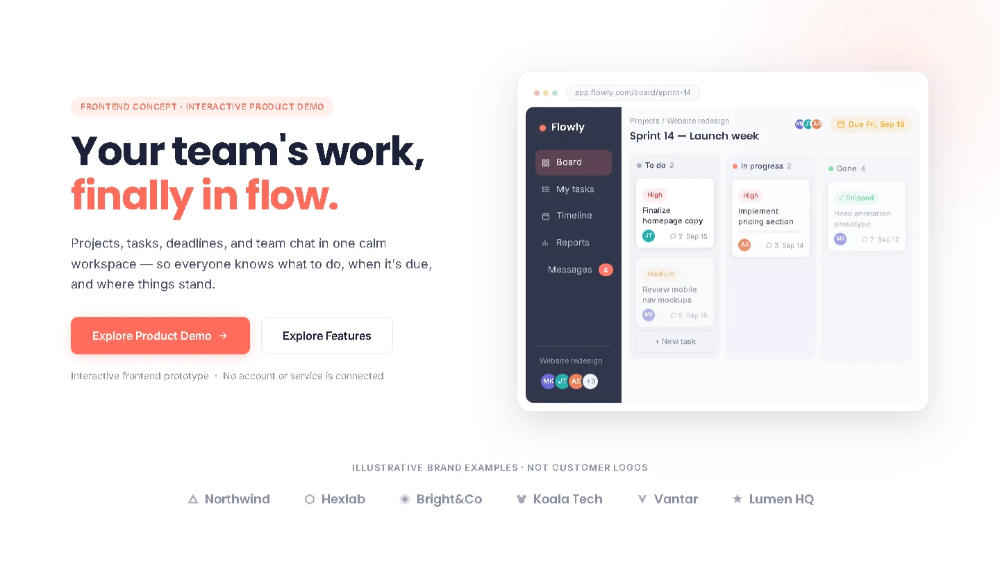
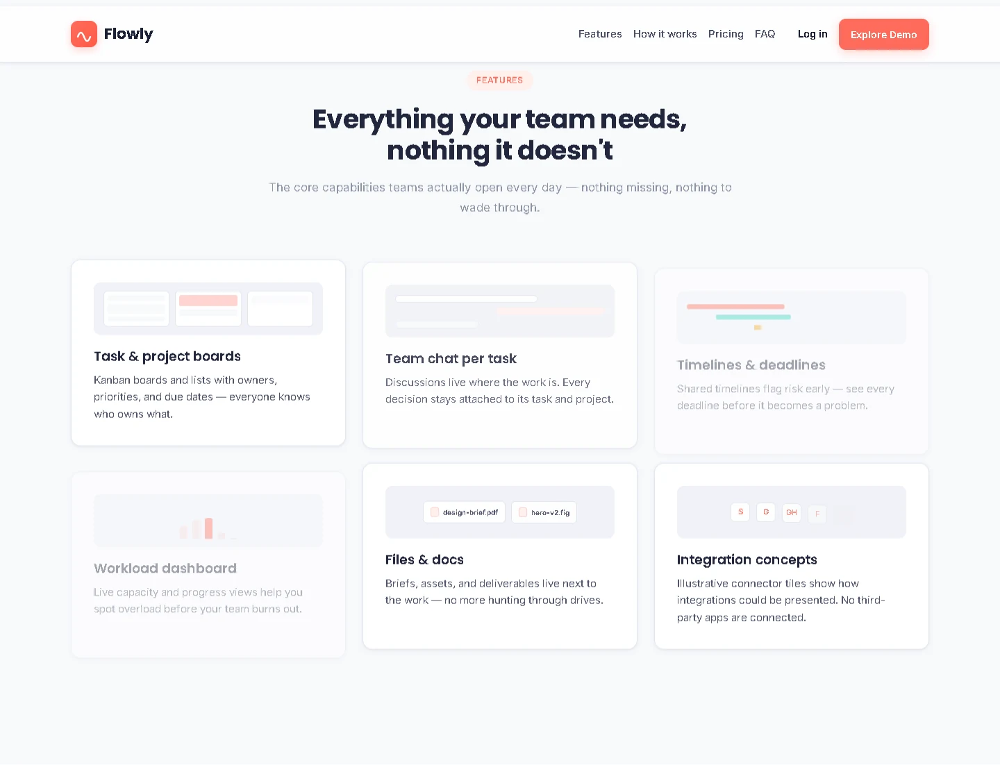
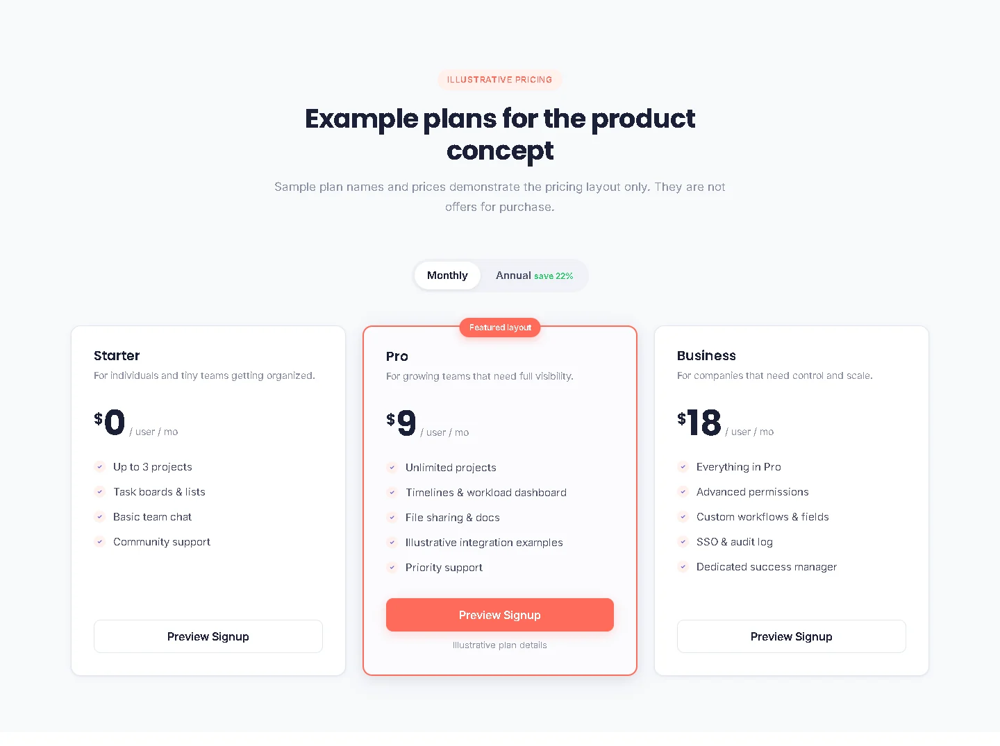
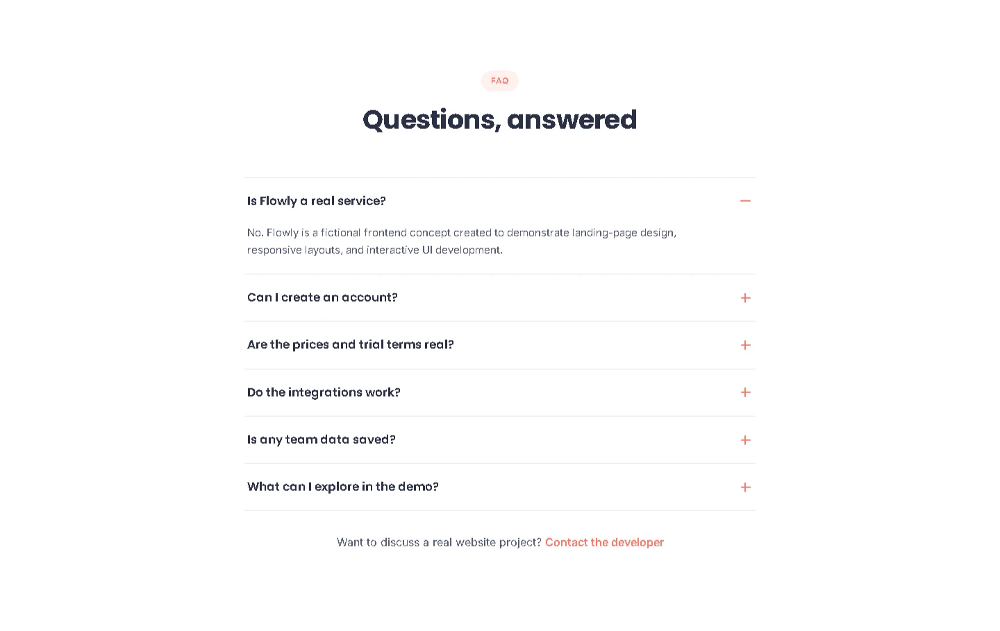
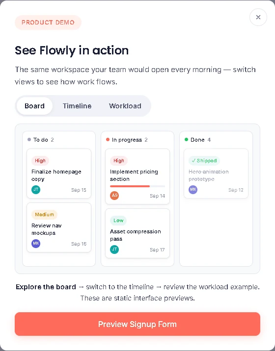
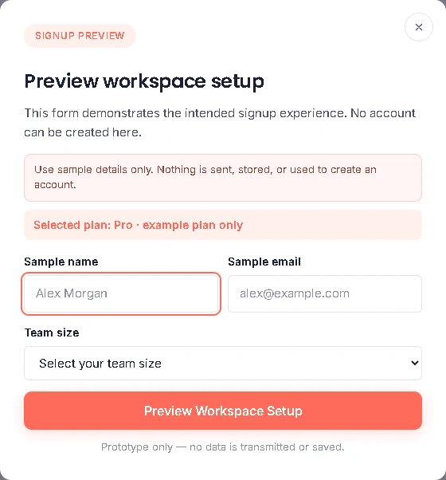
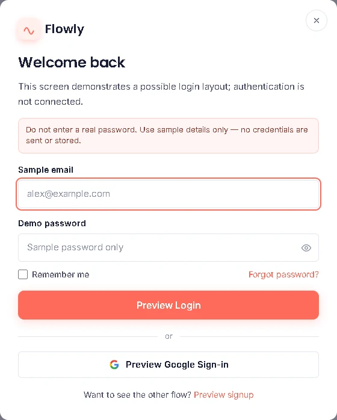
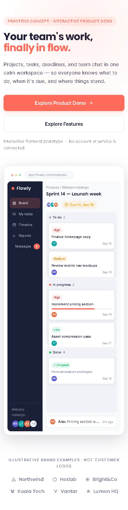

# Flowly — SaaS Landing Page

A fictional team / project management SaaS landing page, designed and developed as a personal frontend portfolio project.

Flowly is **not a real company or live service**. It is a concept project built to demonstrate responsive landing-page design, clean frontend architecture, and accessible interactive UI with HTML, CSS, and vanilla JavaScript.

## Project Overview

Flowly is a fictional productivity SaaS platform concept designed to help teams manage:

- projects
- tasks
- deadlines
- team communication
- progress
- workload

The goal of the project was to create a polished, responsive SaaS landing-page concept — from a demo-led hero through features, illustrative workflow and customer-story sections, example pricing, FAQ, and a final product-demo CTA — with a custom product dashboard UI built in pure HTML/CSS. Product, customer, pricing, and integration content is fictional and clearly labelled as illustrative.

## Live Demo

[Live Demo](https://youssefmohammed12.github.io/Flowly/)

## Screenshots

These are the same optimized captures used in the Flowly case study on the portfolio. They cover the main page sections, interactive UI previews, and the complete mobile experience. The full-height mobile capture is presented separately so its details remain readable.

### Page sections









### Interactive UI previews







### Mobile experience



## Features

- Responsive SaaS landing page
- Custom Flowly product dashboard UI
- Demo-led hero with product-demo and features calls to action
- Interactive product demo modal (Board / Timeline / Workload)
- Explicitly labelled signup and login UI previews (no credentials or personal details are sent or stored)
- Monthly / annual illustrative pricing toggle
- FAQ explaining the fictional product boundary
- Responsive mobile navigation
- Illustrative customer-story and brand-placeholder sections
- Product UI microinteractions and scroll-reveal animations
- Accessible, keyboard-friendly modal interactions
- Reduced-motion support
- Responsive layouts

## Technologies

- HTML5
- CSS3
- Vanilla JavaScript
- Bootstrap 5.3.3 CSS (layout / utilities only — no Bootstrap JS bundle)
- Google Fonts (Inter + Poppins)
- Git / GitHub
- GitHub Pages

## Project Structure

```text
Flowly/
|-- index.html
|-- css/
|   `-- styles.css
|-- js/
|   `-- script.js
|-- images/
|   |-- og-image.png
|   `-- favicon/
|       |-- favicon.svg
|       |-- favicon-32x32.png
|       `-- apple-touch-icon.png
|-- screenshots/
|   |-- hero-desktop.webp
|   |-- features.webp
|   |-- pricing.webp
|   |-- faq.webp
|   |-- product-demo.webp
|   |-- signup-preview.webp
|   |-- login-preview.webp
|   `-- mobile-home.webp
`-- README.md
```

## Design / UX

- SaaS-focused visual identity with a clean, calm workspace feel
- Product-first visuals: dashboard previews lead the hero and supporting sections
- Responsive layout (desktop-first sections that collapse cleanly on mobile)
- Demo-led CTA hierarchy (`Explore Product Demo` primary, `Explore Features` secondary)
- Lightweight animations (reveals, counters, product transitions) that support content
- Consistent UI system (buttons, badges, cards, modals, spacing)
- Accessibility considerations baked into navigation, modals, and motion

## Interactions

- Mobile navigation (hamburger toggle + drawer, closes on link click / resize)
- Pricing toggle (monthly / annual billing switch with updated amounts)
- FAQ accordion (single-open behavior with ARIA expanded states and clear explanations of the fictional product boundary)
- Product demo modal (tabbed Board / Timeline / Workload preview)
- Login and signup UI previews (frontend-only validation and explicit demo-only outcomes)
- Password visibility toggle (show / hide in the login preview)
- Form validation (local preview only; no network submission or data storage)
- Scroll-based animations (IntersectionObserver reveals, illustrative stat counters)
- Product preview transitions (demo view switching, subtle dashboard motion)

## Accessibility

- Semantic HTML (`header`, `main`, `section`, labelled headings, native buttons/forms)
- Visible focus states
- ARIA states / labels where appropriate (`aria-label`, `aria-expanded`, `aria-haspopup="dialog"`, `role="dialog"`, `aria-modal`)
- Keyboard-accessible interactions (all actions reachable and operable by keyboard)
- Modal focus handling (focus moved into dialog, trapped while open, restored on close)
- Escape-to-close behavior (modals and mobile menu)
- Reduced-motion support (`prefers-reduced-motion` disables reveals, counters, and decorative motion)
- Signup/login preview notices advise visitors to use sample details only; browser autocomplete is disabled for demo fields

No WCAG certification is claimed.

## Prototype boundaries

- Flowly is a fictional frontend portfolio concept, not a company or working SaaS product.
- No backend, database, account system, payment flow, newsletter, or third-party integration is connected.
- The signup and login screens are local UI demonstrations; submitted values stay in the page and are not transmitted or persisted.
- Plan names, prices, discounts, setup figures, integrations, brand marks, and testimonial text are fictional layout examples.
- Footer links point to the real Flowly repository and Youssef's portfolio / LinkedIn profile; no fictional contact address or newsletter capture remains.

## QA

A local Chromium / Playwright pass exercised 31 checks, including 16 viewport widths from 320px to 1920px, demo-led navigation, monthly / annual example pricing, the single-open FAQ, mobile navigation, demo tabs, signup / login preview validation, password visibility, focus restoration, preview-state cleanup, and reduced-motion behavior. No browser errors, failed requests, or POST / PUT / PATCH requests occurred. This is a targeted smoke test, not a Lighthouse benchmark or formal accessibility certification.

## SEO / Metadata

The page includes:

- Page `<title>`
- Meta description
- Open Graph metadata (`og:title`, `og:description`, `og:type`, `og:url`, `og:image` 1200×630)
- Twitter/X card metadata (`summary_large_image`)
- Canonical URL: `https://youssefmohammed12.github.io/Flowly/`
- Favicon (SVG + 32×32 PNG)
- Apple touch icon
- `theme-color` meta
- OG image: `https://youssefmohammed12.github.io/Flowly/images/og-image.png`

## Deployment

Static site deployed with GitHub Pages from the repository.

Live URL: [https://youssefmohammed12.github.io/Flowly/](https://youssefmohammed12.github.io/Flowly/)

## Disclaimer

"Flowly is a fictional product concept created for portfolio and learning purposes. The testimonials, branding, product features, pricing, and other business content are illustrative and do not represent a real company or service."
